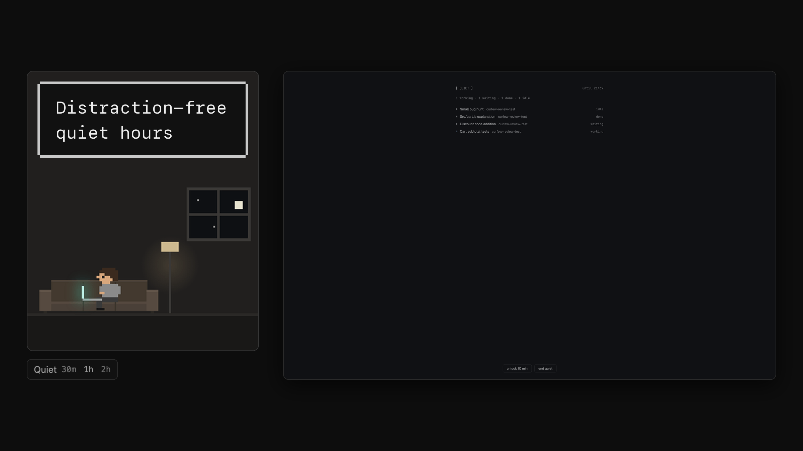

<h1 align="center">Quiet hours</h1>
<h3 align="center">Log off. Your agents won't.</h3>

  A herdr mod that turns your window into a calm, dim board at night, so your agents keep running while you log off.
   
  <a href="#install">Install</a>
  ·
  <a href="docs/reference.md">Reference</a>
  ·
  <a href="https://github.com/curfew-herdr/curfew">Part of Curfew</a>

## About

Choose your hours, or go quiet for half an hour or more before a meeting. Your agents keep
running, and herdr's window becomes a dim board that shows only whether each one is working,
waiting or done. herdr's sounds go off until quiet ends.

You can still look: an unlock gives the window back for ten minutes, then quiet comes back on its
own. Every unlock is logged, and the morning starts with a summary of the night. A change that
would end tonight early waits until tomorrow, unless you say otherwise.

It doesn't make night work impossible; it makes drifting into it visible.

## Install

In herdr, ask your agent:

> Add herdr.dev/mods/curfew-herdr/quiet-hours, and put its chip in my sidebar.

The chip has to sit in a layout to show; the [reference](docs/reference.md#install-step-by-step)
has the steps by hand. Quiet hours start switched off, so installing in the evening doesn't lock
you out: click the clock on the chip to set your hours. `Quiet 30m 1h 2h` works any time.

Using the [Curfew](https://github.com/curfew-herdr/curfew) layout? Quiet hours are already in it.

## Requirements

herdr with herdr-core, node 18 or later, and git. Built on macOS.

## License

[Apache-2.0](LICENSE). [NOTICE](NOTICE) credits the code it builds on.
