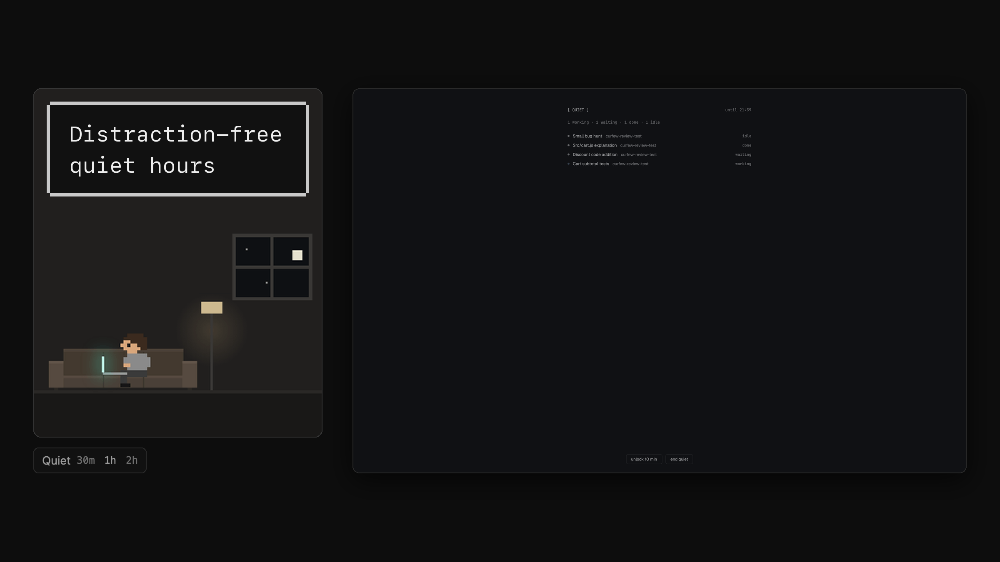

# Quiet hours

At night the window turns into a dim board of your agents and herdr's sounds go off. A small
chip at the foot of the sidebar starts a "quiet now" of 30 minutes to 2 hours, counts down a
logged 10-minute unlock, and opens the settings: per-day hours and a guardrail that keeps a
change from ending tonight early unless you say so. In the morning one notification sums up the
night.

## What you see

The mod draws four things, picked by `props().role`. Colors are the theme's names (they follow
any theme); text is the layout's UI font unless marked mono, which is `settings().font_family`
(else JetBrains Mono).

- **The chip** (`role: "chip"`), a 36 px block at the bottom of a sidebar. The whole block is
  `chrome`, padded 6 px left and right and 8 px at the bottom; one 26 px row sits at its bottom
  edge.
  - Outside quiet: a group with a 4 px radius that takes the `hover` fill as a whole: `Quiet`
    (12.5 px, `muted`, `foreground` while the group is hovered, 8 px left and 6 px right
    padding), then `30m 1h 2h` in mono 11 px, 10 px apart (`1h` in `muted`, the others `dim`,
    each `foreground` under the pointer). At the right end, the opener: herdr's clock icon
    (`mods/workspace-chrome/clock.svg`, 12 px) and, 6 px after it, mono 11 px: when the next
    window starts (`18:00` today, `mon 18:00` on another day, `off` with no schedule), `dim`,
    `muted` under the pointer. A problem (a broken config, the watcher didn't start) replaces
    those words and shows in `muted`.
  - Unlocked: the open lock (`unlock.svg`, 12 px) and `9:52 left` in mono 11 px, both
    `accent`, the countdown ticking each second (`1:05:00` past an hour); then
    `· new hours tomorrow` in `dim` when a change waits for tomorrow; at the right `lock now`
    and, in a quiet now, `end quiet`, mono 11 px `dim`, `muted` under the pointer, no fill.
  - Quiet and locked (only for the moment before the board shows): the opener alone, reading
    `until 08:00`.
  - In a sidebar narrower than 160 px (the `sidebar` node's `size.px`): a 32 px wide icon
    button, centered, `hover` fill: the clock in `dim`, or the open lock in `accent` while
    unlocked.
- **The menu** (`role: "menu"`), a popup 170×136 px on `popover`, 5 px padding, 12.8 px text:
  `Quiet for` (11 px, `dim`), then three 31 px rows with a 7 px radius and the `hover` fill:
  `30 min`, `1 hour`, `2 hours`.
- **The board** (`role: "board"`), the whole window during quiet, on `chrome`. Padding 56 px
  top, 28 px bottom, 40 px at the sides; a centered column at most 560 px wide, 18 px gaps:
  - A row: `[ QUIET ]` (mono 12 px, `muted`) at the left; at the right, mono 12 px `dim`:
    `until 08:00 · 23:41` in a scheduled night, `until 14:30` in a quiet now,
    `next 18:00 · 12:00` outside quiet.
  - A count in mono 12 px `dim`: `2 working · 1 waiting · 3 done`, zero counts left out,
    `nothing running` with no agents.
  - One 28 px row per agent, 10 px gaps: a 6 px dot (`accent` while working, else `dim`), the
    name (13 px, `muted`, at most 240 px: the tab's name if someone named it, else the
    program's), the space's name (12.5 px, `dim`, taking the rest), the status word (mono
    11.5 px, `dim`). The list scrolls.
  - At the bottom, centered: `unlock 10 min` (the configured minutes), and in a quiet now
    `end quiet`: ghost buttons 30 px tall, 14 px side padding, 6 px radius, a 1 px `border`
    line that turns `input` under the pointer, 12.5 px `muted` text. While unlocked, instead,
    `unlocked · 8m left` in mono 12 px `dim`.
  - A problem, if any, under it in 11.5 px `dim`.
  - The rule: at night nothing on the board reads as a message or a call to action. No status
    colors, one slow pulse.
- **The settings dialog** (`role: "settings"`), 500×476 px, modal, with no herdr frame
  (`frame: "none"`): it draws its own. A 3 px margin, then a `popover` body with a 1 px
  `input` border, 2 px radius, 20 px side padding and 16 px top and bottom, 13 px text; a
  5×5 px `dim` square on each of the frame's four corners.
  - Top row: `[ QUIET HOURS ]` and `esc`, mono 10.5 px `dim`.
  - The switch: a 26×14 px pill (1 px border `muted` and `selected` fill when on, `input` and
    `chrome` when off) with an 8 px knob (`foreground` at the right when on, `dim` at the left
    when off), then `Quiet hours on` / `Quiet hours off`.
  - A 1 px `border` hairline, then 30 px rows: a label in an 84 px column (`muted`), a control
    in 136 px, the rest in 150 px, then the row's error (11.5 px, `ansi9`):
    - `Every night`: a segmented `hours | none`, then `18:00 → 08:00` fields, or `no nightly
      window` faint.
    - `Mon` to `Sun`, Monday first: `same | off | custom`. `same` shows the nightly hours faint
      (`18:00  →  08:00`), `custom` its own two fields, `off` nothing.
    - The segmented control: 22 px tall, a 1 px `border` line, 2 px radius, mono 11 px; the
      chosen part on `selected` in `foreground`, the others `dim` (`muted` under the pointer).
    - Time fields: 58×24 px, 7 px padding, 2 px radius, `chrome`, mono 12 px, `HH:MM` as the
      placeholder; the border is `accent` while typing in it, `ansi9` when its error shows,
      else `border`. A `→` in `dim` between the two.
  - A hairline, then `Unlock`: a 48 px field and `minutes` (12.5 px, `dim`).
  - At the bottom, after a hairline: an 18 px message line (12 px; `ansi9` for a failure),
    then `Cancel` and `Save` at the right, 26 px tall, 11 px padding, 2 px radius, 12.5 px
    medium. Save is `solid` on `solid_foreground` text (`Saving…` while it writes); Cancel is
    `popover` with a `border` line. While a write runs both are at 40%.
  - When a Save would end tonight early, the foot asks instead: **Apply tonight?** (semibold)
    *This ends tonight's quiet hours early.* (`muted`), with `No, from tomorrow` and
    `Yes, tonight`.
- **Without a role** (what `herdr-app check` and `mod.open` load): an inert preview of every
  piece side by side on `chrome`: the three chips (idle, unlocked, unlocked with a change for
  tomorrow), the menu and the board in a 350 px column, then the dialog with a mistyped time
  and the dialog asking "Apply tonight?". `mod.json` sizes it: a 1430×520 dialog.

The board's layout, `layouts/quiet-hours.json`: a root column with `"titlebar": "none"`,
`"traffic_lights": [14, 16]`, `"background": "chrome"`, and one block `board`
(`window_drag: true`) holding the mod with `props.role: "board"`.

## How it behaves

- **Agent statuses on the board.** working: the dot is `accent` and pulses (`opacity` 0.3 to 1,
  2600 ms, `.loop`), word `working`. blocked: `waiting`, a `dim` dot (neutral on purpose).
  done: `done`, `dim`. idle: `idle`, `dim`. The count line uses the same words, in the order
  working, waiting, done, idle.
- **When quiet starts** (a scheduled window, or a quiet now), the watcher switches the window
  to `quiet-hours`, remembering the layout that was shown. A switch away from the board while
  locked is logged as `bypass` and switched back within a moment.
- **Unlock** (board): writes an unlock for `unlock_minutes` (default 10). The watcher switches
  back to the remembered layout; the chip counts down; `lock now` ends it. When the unlock runs
  out (`relock`) or is ended (`lock`), the board comes back and an open settings dialog closes.
- **Quiet now** (chip): `Quiet` is 60 minutes, `30m`, `1h`, `2h` are those lengths, from now;
  it replaces any unlock. `end quiet` (board or chip) ends it. In a narrow sidebar the chip's
  icon opens the menu instead (or, while unlocked, locks). A scheduled window wins over a
  quiet now while both cover the time.
- **Settings** open from the opener (outside quiet) or the countdown (while unlocked), never
  from the board and never while locked. Enter in a field saves, Esc closes (or dismisses the
  question). A field's error shows once you leave it; after a Save every error shows. Save
  re-reads the file and writes only over what it read; keys it doesn't edit
  (`return_layout`, anything else) stay.
- **The guardrail.** While a scheduled window runs, the config it started under is held. A
  change that would end it sooner or remove it waits for the window's end (`pending`; the chip
  says `· new hours tomorrow`), unless the Save is answered **Yes, tonight**, which applies it
  for this window once and logs `apply-tonight`. Any other change applies at once and becomes
  the held config.
- **Overnight.** When a scheduled window ends, the chip posts one notification, titled
  `Overnight`: `2 working · 1 done · unlocked 2× (14 min) · 1 bypass · applied tonight at
  23:40`, the parts with nothing left out. Once per night, and only within 12 hours of its end.
- **Sounds.** Entering quiet with herdr's sounds on, the watcher turns them off
  (`settings.json` `sounds.enabled: false`) and back on when quiet ends or the watcher stops.
- **What moves:** the working dot's pulse on the board and the chip's countdown (one redraw a
  second, only while unlocked). Everything else changes when the state file does.

## Built from

- **Files:** `mods/quiet-hours/` with `main.js` (roles, state, actions), `ui.js` (board, chip,
  menu: pure functions of what they're given), `settings.js` (`SettingsForm` holding
  `InputState`s, `settingsDialog`), `form.mjs` (the form to and from `config.json`),
  `clock.mjs` (every rule, pure functions of `now`, no imports: shared by the mod and the
  watcher), `quietd.mjs` (the watcher), `quiet.layout.json` (the board's layout),
  `unlock.svg`, `mod.json` `{ "place": "none", "overlay": { "kind": "dialog", "width": 1430,
  "height": 520 } }`, and tests (`clock.test.mjs`, `form.test.mjs`, `quietd.test.mjs`).
- **Roles:** `board`, `chip` (both keep the watcher running and read the state), `menu`
  (popup), `settings` (dialog), none (the inert preview, no side effects).
- **Data** in `<app home>/quiet-hours/`, outside the mod folder (herdr reloads a mod whose files
  change): `config.json` `{ enabled, default: ["18:00","08:00"] | "none", days: { sun..sat:
  pair | "none" }, unlock_minutes: 1..240, return_layout }`, `control.json` (the mod's
  requests: `unlock {startedAt, until}`, `manual {start, end}`, `applyTonight {windowStart,
  at}`), `state.json` (the watcher's decision: `version, quiet, kind, windowStart, windowEnd,
  nextStart, enabled, unlockMinutes, unlock, held, pending, returnLayout, summary,
  soundsSaved, error`), `log.jsonl`, `quietd.pid`. The mod writes only `control.json` and
  `config.json`, each with `writeTextFile(path, text, expected)` over the text it read (retried
  once); the watcher is the only writer of `state.json` and `log.jsonl`.
- **The watcher** (`node quietd.mjs`): ticks every 15 s and at the next boundary (a window's
  edge, an unlock's end), and 250 ms after `config.json`, `control.json`, `settings.json` or
  `shared.json` change (`fs.watch`). Each tick reads control then config, applies the guardrail,
  works out the window and the unlock, logs what changed, handles the sounds, then reads the
  shown layout from `herdr-app status` and switches with `herdr-app do layout.switch` (waiting up
  to 2 s for the switch to show). It finds `herdr-app` at `$HERDR_APP_BIN`,
  `~/.local/bin/herdr-app`, `~/Applications/Herdr.app/Contents/MacOS/Herdr`,
  `/Applications/Herdr.app/Contents/MacOS/Herdr`, else on `PATH`, and passes `HERDR_APP_HOME`.
  At start it writes `layouts/quiet-hours.json` from `quiet.layout.json` if it is missing (and
  again before switching to it), and a missing config as the defaults with `enabled: false`; a
  broken config keeps the last good one. It returns to `state.returnLayout`, else `return_layout` (default `main`), else
  `main`. A pid file keeps it single; `SIGTERM`/`SIGHUP`/`SIGINT` restore the sounds and exit.
  `VERSION` (3) must match the mod's: a mod that sees another version in `state.json` restarts
  it once.
- **Starting it:** the board and chip run `hc ls --all --json --label quiet-hours.watcher=1`, keep
  one live terminal whose argv ends in `/quietd.mjs` (`hc get <address> --json`), kill the rest,
  `hc rm` dead ones, and if none is live run `hc run --bg --json --no-parent --name
  quiet-hours-watcher --label quiet-hours.watcher=1 --cwd <app home>/quiet-hours -- <node>
  <app home>/mods/quiet-hours/quietd.mjs`, `<node>` being the first of `command -v node`,
  `/usr/local/bin/node`, `/opt/homebrew/bin/node` whose `--version` is 18 or later. No
  `herdr.space`/`herdr.tab` labels, so the terminal stays out of the window. Again every 60 s.
- **herdr functions:** `agents`, `spaces` (which tabs are named), `layout` (the sidebar's
  width), `theme`, `settings`, `props`, `appHome`, `hc`, `exec`, `readTextFile`,
  `writeTextFile`, `watchFolder` (the data folder, with a 15 s timer as a fallback),
  `openOverlay` (menu popup 170×136; settings `kind: "dialog", modal: true, frame: "none"`,
  500×476), `closeOverlay`, `notify`, `shared`/`setShared` (`quiet.summary`: the night already
  summed up); `fs/promises` `mkdir`. Timers: `cx.timer.every(15000)` for the state and clock,
  `cx.timer.every(1000)` on the chip while unlocked.
- **Shipped parts used:** `mods/workspace-chrome/clock.svg` (herdr's, drawn from the person's
  install).
- **Programs:** `node`, `/bin/sh -c "command -v node"`, `hc`, `herdr-app`, `ps` (the pid check).
- **Art:** `unlock.svg`, a 16 px open lock in que's line style (1.5 px stroke, round caps).

## Watch out

- `herdr-app check` runs a mod's `init` against the real app home (and `exec` and `hc` calls
  started there do run), with `props()` and `layout()` null. A copy with no role must do
  nothing: no watcher, no file writes.
- A copy only does something where a layout places it with a role. Copying the folder adds
  nothing to the window: the chip block (`{ "mod": "quiet-hours", "props": { "role": "chip"
  } }`, 36 px) has to be added to a layout. Herdr's own layouts are replaced on every start:
  clone one first (`layout.clone`).
- Move the folder into `mods/` in one rename: a folder herdr sees before its `mod.json` exists
  is docked into the shown layout.
- Closing an overlay cancels its unfinished tasks: the menu and the dialog write first, then
  close.
- No `setTimeout` in the mod (it has none: `cx.timer`, `cx.spawn`); the watcher is plain node
  and may. Never keep a `cx`.
- The board can't hold back herdr's own toasts; they show for about 5 s, silent.
- `ctrl-shift-l` cycling stops at the board in work hours (the watcher switches straight back).
- The escape hatch (`ctrl-alt-shift-escape`) sets the shown layout aside; at night that is the
  board's, which the watcher writes back (and logs a bypass).
- The settings change only the keys the dialog edits; `writeTextFile` refuses a stale snapshot,
  so the mod reads, merges and writes again once.
- `sounds.enabled` is changed as text, so the rest of `settings.json` stays byte for byte.
- A switch away and back within a few hundred ms can go unseen as a bypass.
- The chip uses herdr's `workspace-chrome/clock.svg`; a herdr without it shows no clock icon.
- Assumes node 18+ and a Unix shell on this computer; the board, chip and settings are for this
  computer's herdr-core only.

## Done when

- `herdr-app check mods/quiet-hours` passes and `cd mods/quiet-hours && node --test` passes
  (36 tests).
- `herdr-app do mod.open '{"name":"quiet-hours"}'` shows the preview, and afterwards
  `hc ls --label quiet-hours.watcher=1` lists no new watcher.
- With the chip block in the shown layout, `hc ls --label quiet-hours.watcher=1` lists one live
  terminal within a few seconds, `quiet-hours/config.json` exists with `"enabled": false`, and
  `layouts/quiet-hours.json` exists.
- Clicking `30m` switches the window to `quiet-hours` within a second or two; `herdr-app
  status` reports `"layout": "quiet-hours"` and `settings.json` has `"enabled": false` under
  `sounds`. `end quiet` switches back to the layout that was shown and turns the sounds on.
- In quiet, `unlock 10 min` switches back and the chip counts down from `10:00 left`;
  `lock now` brings the board back; `log.jsonl` has `manual-start`, `unlock`, `lock` lines.
- Switching to another layout while the board is locked is undone and logged as `bypass`.
- The settings dialog refuses `25:00` with `use HH:MM` and doesn't write; saving valid hours
  updates `config.json` and the chip's next start.
- In a scheduled night, saving an earlier end asks *Apply tonight?*; **No, from tomorrow** leaves
  `state.json` `pending: true`; **Yes, tonight** logs `apply-tonight` and ends the night at the
  new time.
- `hc kill quiet-hours-watcher` puts `sounds.enabled` back and removes `quietd.pid`.
